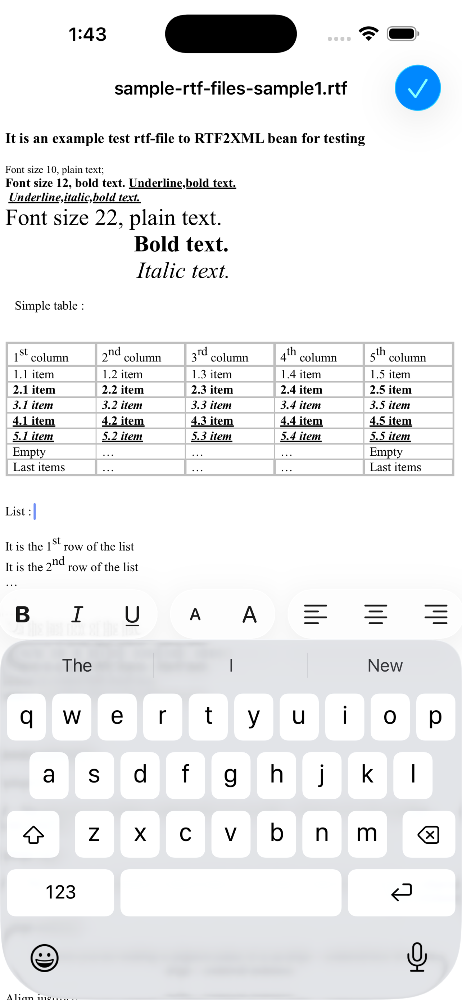

# KoalaTVault

An offline, encrypted file vault for iPhone and iPad. Keep photos, videos and documents in a private vault on your
device, organise them in folders, view and edit them inside the app, and move files in and out when you need to.

No accounts, no servers, no third-party code. The only network use is the App Store purchase.

<p align="center">
  
  &nbsp;&nbsp;
  
</p>

## Features

- **Multiple vaults.** There is always one unencrypted vault, and you can add encrypted vaults, each with its own name
  and password. A password opens only its own vault, so a second vault works as a decoy (duress) vault. Nothing in the
  app shows how many encrypted vaults exist.
- **Face ID / Touch ID.** One encrypted vault can also be opened with biometrics.
- **Auto-lock.** The app locks whenever it goes to the background, and a privacy cover hides the vault in the app
  switcher.
- **File browser.** A grid of folders and files with thumbnails. Sort by name, type or date. Move, copy, rename and
  delete files one at a time or in bulk, or drag a file onto a folder to move it.
- **Import** from Files (single files or whole folders) and from the photo library, with duplicates detected
  automatically.
- **Viewer.** Zoomable images, streaming video playback, and QuickLook for other file types.
- **Rich-text notes.** A built-in `.rtf` editor with autosave.
- **Export** to Files or the Camera Roll, and move or copy items between vaults.
- **Recently Deleted.** Deleted items are kept for 30 days per vault and can be restored.
- **Unlock Pro.** A one-time purchase removes the free limit of 100 files per vault and allows more than one encrypted
  vault.

## Security model

- Each encrypted vault has a random 256-bit master key. The key is stored in the Keychain, wrapped with a key derived
  from your password (PBKDF2-HMAC-SHA256, 600,000 iterations, NFC-normalised password).
- Files are stored in the **SVC5** format: the file is split into 1 MiB chunks, each encrypted with AES-256-GCM using
  a per-file key (HKDF-SHA256 from the master key), with the header and chunk index bound in as authenticated data.
- In an encrypted vault, file names are encrypted too: files are stored under random UUIDs, and each folder's index
  mapping UUIDs to real names is itself AES-GCM encrypted.
- When a vault closes, its key and any decrypted temporary files are wiped.
- Built only on Apple frameworks: CryptoKit, CommonCrypto, Security, LocalAuthentication.

**Known limits:**

- Folder names and folder structure are stored in plaintext on disk.
- With direct access to the device, someone can count the encrypted vaults (vault folders and Keychain items), even
  though the app never shows the number.
- There is no minimum password strength yet. The wrapped key is included in device backups, so a weak password can be
  guessed offline.
- There is no password recovery: a lost password means a lost vault.

Fixes for these are planned.

## Requirements

- iOS 16.6 or later, on iPhone and iPad in all orientations
- Xcode 16 or later to build

## Building and running

1. Open `KoalaTVault.xcodeproj` in Xcode.
2. Select the `KoalaTVault` scheme and a simulator or device.
3. Build and run (⌘R).

To try the Pro purchase without the App Store, choose the StoreKit configuration
`KoalaTVaultTests/premiumTesting.storekit` in the scheme's run options.

## Tests

The app has unit tests (`KoalaTVaultTests`, one folder per module) and end-to-end UI tests for each user journey
(`KoalaTVaultUITests`). Run them in Xcode with ⌘U, or from the command line:

```sh
xcodebuild test \
  -project KoalaTVault.xcodeproj \
  -scheme KoalaTVault \
  -destination 'platform=iOS Simulator,name=iPhone 16 Pro,OS=18.6'
```

Use an iOS 18.x simulator. On iOS 26.x simulators, StoreKit test sessions fail under `xcodebuild` (Apple FB22237318).

UI tests launch the app with `-uiTesting`, which runs it against a temporary vault, an in-memory Keychain and throwaway
settings, so the tests never touch real data. These test hooks are compiled only into Debug builds.

## Project layout

```
KoalaTVault/
  Modules/<Module>/        one folder per module
    Contracts/             the module's public protocols and models
    Mocks/                 test and preview doubles
    Views/                 UIKit screens, if any
  AppDependencies.swift    composition root: builds the live services
  SceneDelegate.swift      app lock, root browser, post-unlock tasks
KoalaTVaultTests/<Module>/ unit tests per module
KoalaTVaultUITests/        journey tests
docs/
  outline.md               full spec: journeys, screens, data formats, modules, decisions
  api/<Module>.md          contract snapshot of each module
  features/                feature briefs
```

Modules, from foundation to UI: VaultCrypto, Preferences, Entitlements, VaultStore, SharedUI, VaultLock,
LockMigration, VaultTransfer, Media, Import, Export, LockScreens, Viewer, Settings, Browser. Each module depends only on
the contracts of the modules before it. [`docs/outline.md`](docs/outline.md) has the full spec, including the on-disk
and Keychain formats.

## How it's built

The app is developed with an agent pipeline driven by Claude Code. Each module is specified in `docs/outline.md`,
tested from that spec first, then implemented, and must pass build, lint, test, coverage and contract gates before it is
merged. The `.pipeline/` and `.claude/` folders hold the pipeline's state and settings.
